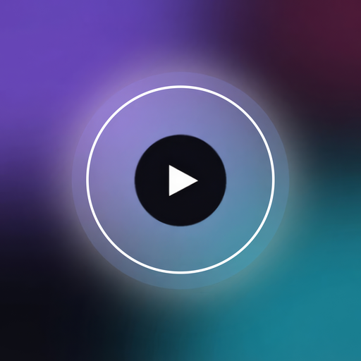

<p align="center">
  
</p>

# Aura-Deck

Ein moderner Navidrome-Client für Kodi (ab Kodi 20 „Nexus“, alle Plattformen).

Aura-Deck bringt ein eigenes Vollbild-Fenster mit Startseite, Künstlerseiten und
„Läuft gerade“-Ansicht mit. Abgespielt wird über Kodis eigenen Player, deshalb
funktionieren lückenlose Wiedergabe, ReplayGain, Crossfade, Visualisierungen,
Medientasten und Fernbedienungs-Apps wie Kore oder Yatse weiter.

## Funktionen

- **Startseite** mit Begrüßung, Schnellstart (Zufallsmix, Favoriten-Mix) und Reihen:
  Zuletzt gespielt, Neu hinzugefügt, Playlists, Lieblingsalben, Entdecken,
  Meistgespielt, Bestbewertet
- **Künstlerseiten** mit Bild, Biografie, beliebten Titeln, Alben/Singles/Kompilationen
  und ähnlichen Künstlern, dazu Zufallswiedergabe und Künstler-Mix
- **Alben** als Cover-Raster mit acht Sortierungen; es wird beim Scrollen nachgeladen,
  ohne „Mehr laden“-Ordner
- **Album- und Playlist-Seiten** mit Trennern bei mehreren CDs, Favorit, Download,
  Bewertung und Warteschlange; Playlists lassen sich sortieren (Playlist-Reihenfolge,
  zuletzt hinzugefügt, Titel, Künstler, Album, Länge)
- **Suche** mit Verlauf, Ergebnisse nach Titeln, Künstlern und Alben gruppiert;
  ohne Suchbegriff lassen sich Genres durchstöbern
- **Favoriten, Genres** (Kacheln mit Album-Cover, Genre-Mix), **Internetradio,
  Playlists** (anlegen, umbenennen, löschen, Titel hinzufügen und entfernen)
- **„Läuft gerade“** mit großem Cover, synchronisiertem Songtext (OpenSubsonic),
  Warteschlange, Zufall/Wiederholen, Favorit und Song-Mix
- **Offline**: Alben, Playlists oder einzelne Titel herunterladen, inklusive Cover.
  Die Offline-Bibliothek funktioniert auch ganz ohne Server
- **Scrobbling** als Hintergrunddienst. Gezählt wird die tatsächlich gehörte Zeit,
  Pausen und Spulen zählen nicht
- **Lokale Serveradresse** (optional): zu Hause direkt im Heimnetz streamen, unterwegs
  automatisch über die öffentliche Adresse
- **Widgets** für den Kodi-Home-Screen (siehe unten)
- Deutsch und Englisch

## Installation

Voraussetzung: Kodi 20 „Nexus“ oder neuer und ein Navidrome-Server. Aura-Deck nutzt
die Subsonic-Schnittstelle, getestet ist es aber nur mit Navidrome.

1. Die ZIP `script.auradeck-<version>.zip` unter **Releases** herunterladen.
2. In Kodi unter *Einstellungen → System → Add-ons* „Unbekannte Quellen“ erlauben.
3. *Einstellungen → Add-ons → Aus ZIP-Datei installieren* und die ZIP auswählen.
4. Aura-Deck unter *Musik → Add-ons* starten. Der Assistent fragt nach Serveradresse,
   Benutzername und Passwort.

Ein Update installierst du genauso: neue ZIP über die alte installieren. Einstellungen
und Offline-Downloads bleiben erhalten.

Wer selbst baut: `python3 tools/build.py` erzeugt die ZIP in `dist/`.

Das Passwort wird nicht gespeichert. Aura-Deck legt nur einen Anmelde-Token
(Subsonic `t`/`s`) mit festem Salt ab. Dadurch bleiben auch die Cover-URLs stabil
und Kodis Bild-Cache bleibt wirksam. Navidrome-Konten mit LDAP- oder
Reverse-Proxy-Anmeldung unterstützen keine Token-Anmeldung.

## Schneller Start von Titeln

- **Lokale Adresse:** Läuft der Server bei dir zu Hause, trage in den Einstellungen unter
  *Server → Lokale Adresse* seine LAN-Adresse ein (z. B. `http://192.168.0.10:4533`).
  Ist sie erreichbar, streamt Aura-Deck direkt darüber statt über das Internet bzw.
  Cloudflare. Unterwegs wird automatisch die öffentliche Adresse genutzt.
- **Server hinter Cloudflare / HTTP/2:** Kodis HTTP/2-Verbindungen können hängen bleiben,
  wenn mehrere Downloads gleichzeitig laufen (Stream, nächster Titel, Cover). Das zeigt
  sich als „Timeout was reached“ oder „HTTP2 framing layer“ im Kodi-Log und als lange
  Wartezeit beim Titelwechsel. Abhilfe schafft `userdata/advancedsettings.xml`:

  ```xml
  <advancedsettings version="1.0">
    <network>
      <disablehttp2>true</disablehttp2>
    </network>
  </advancedsettings>
  ```

## Bedienung

| Taste | Wirkung |
|---|---|
| Links (am Rand) | Seitenleiste öffnen |
| Zurück | eine Seite zurück, auf der obersten Ebene zur Seitenleiste, dann beenden |
| Kontextmenü / lange OK | Aktionen zum markierten Eintrag (Als Nächstes, Playlist, Favorit, Download …) |
| Info | „Läuft gerade“ öffnen |
| Runter (unten) | Mini-Player |

## Widgets

`plugin://script.auradeck/` selbst öffnet die App. Alle Widget-Quellen stehen unter
`plugin://script.auradeck/?action=widgets`, einzeln lassen sie sich so eintragen:

```
plugin://script.auradeck/?action=albums&type=recent     # zuletzt gespielt
plugin://script.auradeck/?action=albums&type=newest     # neu hinzugefügt
plugin://script.auradeck/?action=albums&type=starred    # Lieblingsalben
plugin://script.auradeck/?action=albums&type=random     # Entdecken
plugin://script.auradeck/?action=playlists
plugin://script.auradeck/?action=songs&source=random
plugin://script.auradeck/?action=songs&source=starred
plugin://script.auradeck/?action=songs&source=offline
```

Über das Kontextmenü eines Widget-Eintrags öffnet „In Aura-Deck öffnen“ das Album
direkt im App-Fenster. Ist das Fenster schon offen, springt es dorthin, statt ein
zweites Fenster zu öffnen.

## Projektaufbau

```
script.auradeck/                 das Add-on (dieser Ordner kommt ins ZIP)
  plugin.py          Einstieg aus Kodi: öffnet die App bzw. liefert Widgets
  default.py         das App-Fenster (von plugin.py gestartet)
  service.py         Hintergrunddienst fürs Scrobbling
  resources/lib/
    subsonic.py      Subsonic/OpenSubsonic-Client (ohne Kodi-Abhängigkeit)
    connection.py    Client aus den Einstellungen, Einrichtungsassistent
    items.py         ListItem-Bausteine
    player.py        Warteschlange über Kodis Player
    actions.py       Favoriten, Bewertungen, Playlists, Downloads
    offline.py       Offline-Cache über xbmcvfs
    scrobbler.py     Hintergrunddienst
    widgets.py       Plugin-Verzeichnisse für Widgets
    ui/window.py     Hauptfenster: Navigation, Fokus, Rendern, Kontextmenüs
    ui/pages.py      Seiten (laden nur Daten, das Fenster zeichnet sie)
    ui/nowplaying.py „Läuft gerade“
    ui/ids.py        Control-IDs, gemeinsam mit dem Skin-Generator
    ui/skin.py       passt die Schriften des Fenster-XML an den aktiven Skin an
  resources/skins/Default/       generiertes Skin-XML, Grafiken in media/auradeck/
assets/
  icon-source.png    Original des Icons (das Addon nutzt eine 512×512-Kopie)
LICENSE, NOTICE, LICENSES/   Lizenztexte (siehe unten)
tools/
  build.py           alles neu erzeugen und ZIP bauen
  i18n.py            alle Texte (EN/DE): erzeugt strings.po und strings.py
  make_skin.py       erzeugt das Fenster-XML
  make_settings.py   erzeugt settings.xml
  make_media.py      zeichnet Icons, Masken, Verläufe; das Seitenleisten-Logo
                     entsteht aus icon.png (icon.png und fanart.jpg selbst
                     werden nie überschrieben)
```

Skin-XML, Sprachdateien, `settings.xml` und `strings.py` werden **generiert**. Ändern
solltest du sie in den Generatoren unter `tools/` und danach `python3 tools/build.py`
ausführen. Neue Texte kommen immer ans Ende der Tabelle in `tools/i18n.py`, sonst
verschieben sich die String-IDs.

## Kodi-Eigenheiten beim Skin

Diese Punkte hat erst der Test im echten Kodi 21 gezeigt. Der Generator berücksichtigt sie:

- Bedingungen gruppiert man mit `[ ]`, runde Klammern gehören nur zu Funktionen.
- `String.IsEqual` vergleicht nicht mit `$INFO[...]`. Der laufende Titel wird deshalb
  von Python als Eigenschaft `playing` markiert.
- `<itemlayout condition=…>` gilt für die ganze Liste, nicht pro Eintrag. Unterschiede
  pro Eintrag entstehen über `<visible>` innerhalb eines Layouts.
- Labels kennen `aligny` nur als `top` oder `center`.
- Labels in Listen-Layouts brechen nie um: Kodi ignoriert dort `wrapmultiline` und kürzt
  mit „…“. Mehrzeiliger Text in Listen (Songtexte) braucht eine `textbox`.
- Fortschrittsbalken und Schieberegler skalieren Füllung bzw. Knopf relativ zur Höhe
  der Hintergrund-Textur. Beide Texturen müssen gleich hoch sein.
- Kodi sucht eine Textur zuerst im aktiven Skin und erst danach im Add-on. Ein Skin mit
  eigener `logo.png` oder `white.png` überdeckt sonst unsere. Alle Grafiken liegen
  deshalb in `media/auradeck/`, der Generator setzt den Ordner vor jeden Namen.
- Schriftnamen gelten nur in der `Font.xml` des aktiven Skins. Andere Skins haben andere
  Größen unter demselben Namen, Großbuchstaben-`_title`-Schriften oder gar keinen
  passenden Namen (dann nimmt Kodi `font13`).

## Hinweise und Grenzen

- Das Fenster-XML ist mit den Schriften von Estuary gebaut. Vor dem Öffnen ordnet
  `ui/skin.py` jeder davon die Schrift des aktiven Skins mit der nächsten Größe und
  Stärke zu und öffnet eine angepasste Kopie aus `addon_data`. Die Größen stimmen dann
  in jedem Skin, die Schriftart selbst bleibt die des Skins. Lässt sich die `Font.xml`
  nicht lesen, öffnet Aura-Deck sein eigenes XML.
- Songtexte kommen aus Navidrome (eingebettet oder `.lrc`). Synchronisiert werden sie
  angezeigt, wenn der Server die OpenSubsonic-Erweiterung `songLyrics` anbietet.
- „Beliebte Titel“ und Künstlerbiografien brauchen in Navidrome einen aktivierten
  Agenten (z. B. Last.fm).

## Sicherheit

Aura-Deck speichert nie das Passwort, sondern einen Subsonic-Anmelde-Token in den
Kodi-Einstellungen. Wer diesen Token hat, kann sich damit am Navidrome-Konto anmelden.
Kodi schreibt Stream-Adressen samt Token (`t=…&s=…`) in sein Log. **Vor dem Teilen
eines Kodi-Logs**, etwa in einem GitHub-Issue, diese Werte unkenntlich machen.

## Lizenz

Aura-Deck ist freie Software unter der **GNU General Public License v3.0 oder neuer**
(GPL-3.0-or-later), Copyright (C) 2026 CasX61. Du darfst es nutzen, verändern und
weitergeben. Wer eine veränderte Fassung weitergibt, muss sie ebenfalls unter der GPL
und mit Quellcode veröffentlichen. Der vollständige Text steht in [`LICENSE`](LICENSE).

Die Icons basieren auf Googles [Material Icons](https://github.com/google/material-design-icons)
(Apache License 2.0, [`LICENSES/Apache-2.0.txt`](LICENSES/Apache-2.0.txt)). Details zu
Fremdmaterial stehen in [`NOTICE`](NOTICE). Aura-Deck ist kein offizielles Projekt von
Navidrome.
